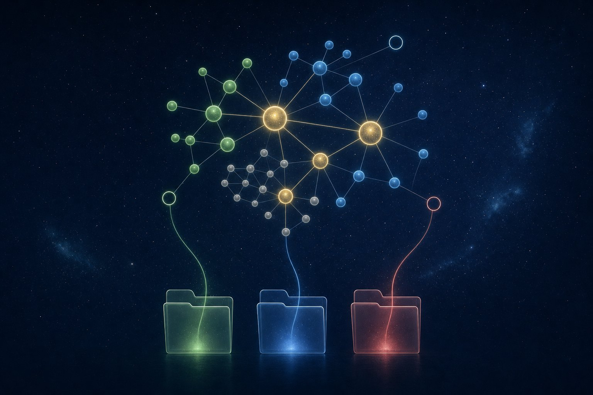
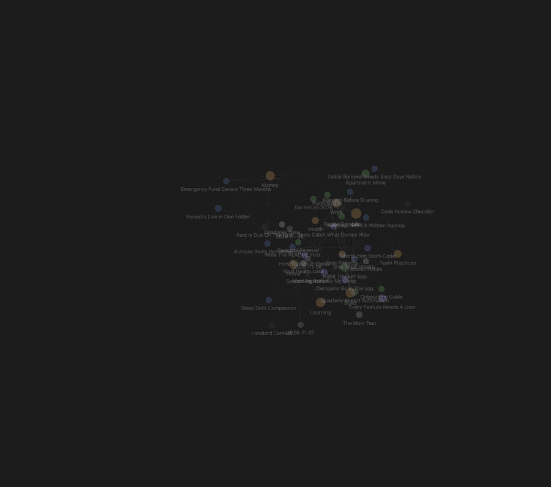
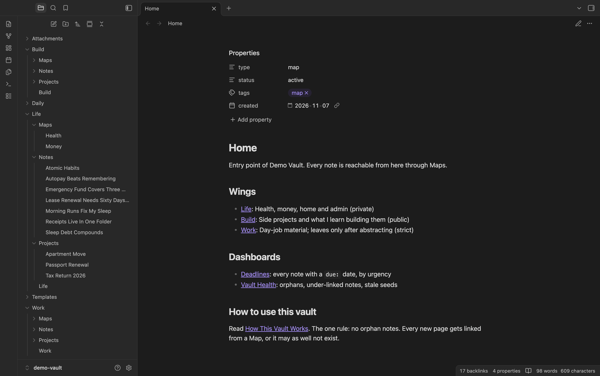
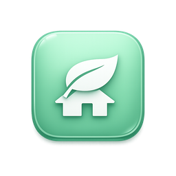
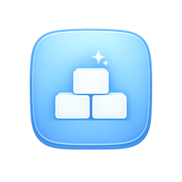
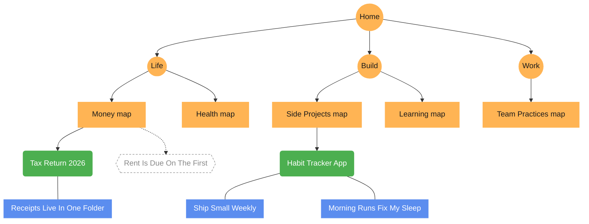
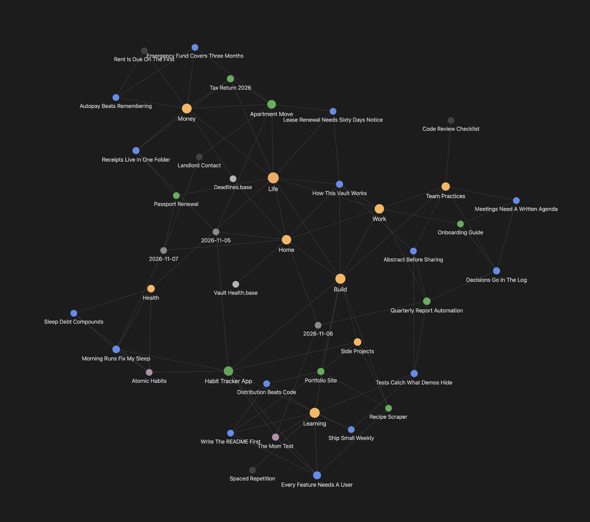
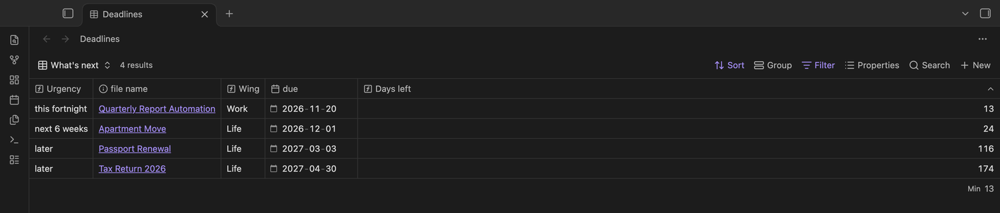
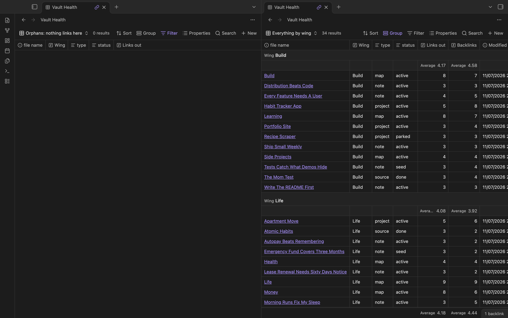
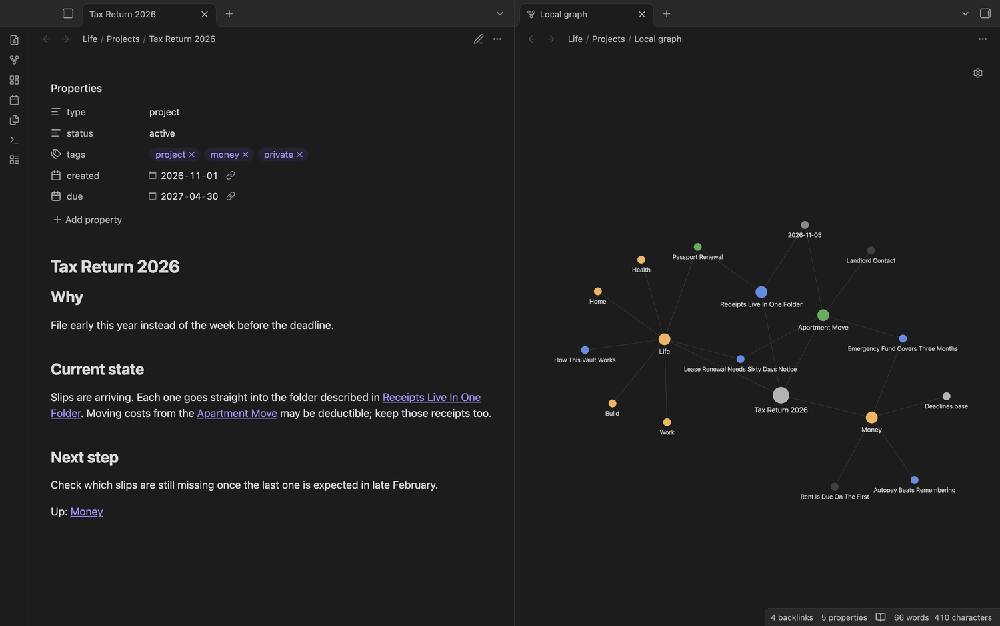

<p align="center">
  
</p>

<h1 align="center">personal-knowledge-vault</h1>

<p align="center">
  <b>Your AI agent builds your Obsidian second brain, and keeps it linked as it grows.</b><br>
  An open Agent Skill for Claude Code, Codex, Cursor, Gemini CLI and other agents that support skills.
</p>

<p align="center">
  <a href="LICENSE"></a>
  
  
  
  
  
</p>

<p align="center">
  
  <br><sub>A real recording of <a href="examples/demo-vault">examples/demo-vault</a> in Obsidian: the graph settles, then hovering a note lights up its links.</sub>
</p>

---

You talk; your agent writes the notes. It files each one in the right **wing**, links it into a
**Map**, puts real deadlines where a dashboard can sort them, and keeps private material in private
folders. Nothing ends up as an orphan you never find again.

**Contents:** [What you get](#what-you-get) · [Three wings](#three-wings-one-per-audience) ·
[The rules](#the-rules-your-agent-follows) · [The graph](#how-the-graph-comes-out) ·
[Dashboards](#dashboards) · [Install](#install) · [Use](#use) · [Demo vault](#try-the-demo-vault) ·
[Scripts](#the-two-scripts) · [Safety](#safety)

## What you get

<p align="center">
  
</p>

One command (or one sentence to your agent) creates the whole structure:

| | File or folder | What it is |
|---|---|---|
| 🏠 | `Home.md` | The top Map. Links to every wing and both dashboards. |
| 📘 | `How This Vault Works.md` | The rules, written for you. |
| 🤖 | `CLAUDE.md`, `AGENTS.md` | The same rules for your agent, loaded every session. |
| ⏰ | `Deadlines.base` | Every note with a `due:` date, sorted by urgency. |
| 🩺 | `Vault Health.base` | Orphans, under-linked notes, missing frontmatter, stale seeds. |
| 🧩 | `Templates/`, `Daily/`, `Attachments/` | Note templates, daily log, files. |
| 🗂️ | `<Wing>/` with `Maps/`, `Projects/`, `Notes/` | One folder per audience, each with its own entry Map. |

<details>
<summary>The same layout as plain text</summary>

```
MyVault/
├── Home.md                  ← start here: links to every wing
├── How This Vault Works.md
├── CLAUDE.md, AGENTS.md     ← rules your agent reads every session
├── Deadlines.base           ← every dated note, by urgency
├── Vault Health.base        ← orphans, under-linked notes, stale seeds
├── Templates/  Daily/  Attachments/
└── Life/  Build/  Work/     ← "wings", one per audience (you choose them)
    ├── Life.md              ← the wing's Map
    └── Maps/  Projects/  Notes/
```
</details>

## Three wings, one per audience

Notes split first by **who may see them**, not by topic. Leaks happen when audiences share a folder.
You choose the names; the audience decides how the agent treats them.

<table>
  <tr>
    <td align="center" width="33%"><br><b>private</b><br><sub>e.g. <code>Life/</code></sub></td>
    <td align="center" width="33%"><br><b>public</b><br><sub>e.g. <code>Build/</code></sub></td>
    <td align="center" width="33%"><br><b>strict</b><br><sub>e.g. <code>Work/</code></sub></td>
  </tr>
  <tr>
    <td>Health, money, family, admin. Only for you. Notes get the <code>private</code> tag.</td>
    <td>Things you build and share. Anything here can become a post, a talk or a site.</td>
    <td>An employer's or client's material. Leaves only after names, links, IDs and numbers are abstracted away.</td>
  </tr>
</table>

## The rules your agent follows

<p align="center">
  
</p>

| Rule | Why it exists |
|---|---|
| **No orphans.** Every note links out to at least two notes and is listed in its parent Map. | A note no Map lists is never found again, so it goes stale. |
| **Maps, not folders.** Folders are storage; Maps are the index. | Everything stays reachable from `Home`, however deep the tree gets. |
| **Titles are claims.** `Receipts Live In One Folder`, not `Receipts`. | A claim can be linked mid-sentence; a topic is a junk drawer. |
| **Unresolved links are the to-do list.** | Linking an idea before writing it gives you a free backlog in the graph. |
| **Real deadlines go in `due:`.** | A date that lives only in a sentence rots; `Deadlines.base` can sort a property. |
| **Chat dies, the vault doesn't.** | Tell the agent something durable and it writes it into the right note in the same turn. |
| **Never delete, never overwrite.** | Notes are parked or archived; the scaffold skips files that exist. |

## How the graph comes out

Links, not folders, shape Obsidian's graph. These rules grow the same spine in every vault:



<p align="center">
  
  <br><sub>The demo vault's real graph. <b>Gold</b> = Maps · <b>green</b> = projects · <b>blue</b> = notes · <b>purple</b> = sources · <b>grey</b> = daily notes · <b>dark dots</b> = ideas not written yet.</sub>
</p>

Colours come from each note's `type` property; the scaffold writes the colour groups and hides
templates and the agent rules files from the graph.

## Dashboards

Both dashboards are Obsidian **Bases**: live tables over your notes' properties and links.

<p align="center">
  
  <br><sub><b>Deadlines.base</b>: every note with a <code>due:</code> date, soonest first.</sub>
</p>

<p align="center">
  
  <br><sub><b>Vault Health.base</b>: zero orphans on the left; links out and backlinks per note, grouped by wing, on the right.</sub>
</p>

### One note, up close

<p align="center">
  
  <br><sub>A project note: frontmatter contract on top, links inside the sentences, and its local graph two hops out.</sub>
</p>

## Install

You need [Obsidian](https://obsidian.md) and an agent that supports skills.

**Any agent, with the skills CLI** (needs Node.js):

```bash
npx skills add YSMsimon/personal-knowledge-vault -g     # for every project
npx skills add YSMsimon/personal-knowledge-vault        # for the current folder only
```

**Claude Code, as a plugin:**

```
/plugin marketplace add YSMsimon/personal-knowledge-vault
/plugin install personal-knowledge-vault@personal-knowledge-vault
```

**By hand:** copy `skills/personal-knowledge-vault/` into `~/.claude/skills/` (Claude Code) or your
agent's skills folder.

**Recommended companion skills**, which teach the agent Obsidian's file formats
(by [Steph Ango](https://github.com/kepano/obsidian-skills)):

```bash
npx skills add kepano/obsidian-skills
```

## Use

Start a new agent session and just ask:

| You say | The agent does |
|---|---|
| "Set up a personal database in Obsidian. Separate areas for health and money, side projects, and my job." | Asks a few questions, scaffolds the vault with three wings, explains how to open it. |
| "Write down that my lease renews on March 1." | Updates the lease note (or creates one), adds `due: 2027-03-01`, links it into the Money Map. |
| "Bring my old notes in `~/Downloads/notes-export` into the vault." | Migrates in small batches, renames to claims, links each into a Map, never deletes. |
| "Check my vault for orphans and fix them." | Runs the health check and links every orphan into its Map. |

## Try the demo vault

[`examples/demo-vault`](examples/demo-vault) is the vault in every screenshot above: 37 sample notes
across three wings, with deadlines, sources, daily notes and four unwritten ideas. In Obsidian choose
**Open folder as vault** and pick that folder. It contains no real person's data.

## The two scripts

Both use only the Python standard library and make no network calls.

```bash
# create a vault (never overwrites an existing file)
python3 skills/personal-knowledge-vault/scripts/scaffold_vault.py --vault "~/Documents/My Vault" \
  --wing "Life|private|Health, money, family" \
  --wing "Build|public|Things I share" \
  --wing "Work|strict|Employer material"

# read-only health report
python3 skills/personal-knowledge-vault/scripts/check_vault.py "~/Documents/My Vault"
```

<details>
<summary>Sample health report (demo vault)</summary>

```
# Vault health: demo-vault

37 notes checked (skipping .trash, Archive, Templates and hidden folders). Home note: Home.md. Daily folder: Daily.

## Duplicate file names: 0
Fix these first: links to a duplicated name are ambiguous, so every other count can be off.

## Orphans (nothing links here): 0
Add each to its parent Map.

## Not reachable from Home: 0
Linked from somewhere, but no chain of links leads here from Home. Usually a Map is missing a link.

## Under-linked (fewer than 2 links out): 0

## Missing frontmatter: 0

## Unknown frontmatter values: 0
Fine if the owner added a new type on purpose (then add a graph colour group for it).

## Untitled files: 0
Rename to a claim or a real name, then fix links.

## Overdue: 0

## Due in the next 14 days: 1
- Work/Projects/Quarterly Report Automation.md: due 2026-11-20 (in 13 days)

## Unresolved links (the backlog, not errors): 4
- [[Landlord Contact]] from 2 note(s)
- [[Rent Is Due On The First]] from 2 note(s)
- [[Spaced Repetition]] from 1 note(s)
- [[Code Review Checklist]] from 1 note(s)
```
</details>

## Safety

- **The agent never deletes notes.** It parks or archives them.
- **The scaffold never overwrites** an existing file, and **the checker only reads.**
- **Secrets stay out:** the agent won't store passwords, keys, card or ID numbers, and flags them during migration.
- **Wings stay separate:** private material never goes into public notes without your say-so.
- **Review any skill before installing it.** Skills run with your agent's permissions; this one is short and readable.

## Repository layout

```
personal-knowledge-vault/
├── skills/personal-knowledge-vault/   ← the skill itself
│   ├── SKILL.md                        workflows and rules
│   ├── references/                     conventions, graph & Bases, migration, installing
│   ├── scripts/                        scaffold_vault.py, check_vault.py
│   └── assets/                         templates, Bases, agent rules
├── examples/demo-vault/               ← the vault in the screenshots
├── docs/assets/                       ← README images
└── .claude-plugin/                    ← Claude Code plugin manifest
```

## Credits

- Conventions from a real vault of 1,100+ notes that an agent has run since August 2026.
- Obsidian skills by [Steph Ango (kepano)](https://github.com/kepano/obsidian-skills).
- Screenshots and the GIF are real captures of the demo vault in Obsidian. The banner, the wing
  icons and the illustration were generated with OpenAI image models; prompts are in
  [docs/assets/PROMPTS.md](docs/assets/PROMPTS.md).

## Author

Shimeng (Simon) Yang · [github.com/YSMsimon](https://github.com/YSMsimon)

## License

[MIT](LICENSE)
